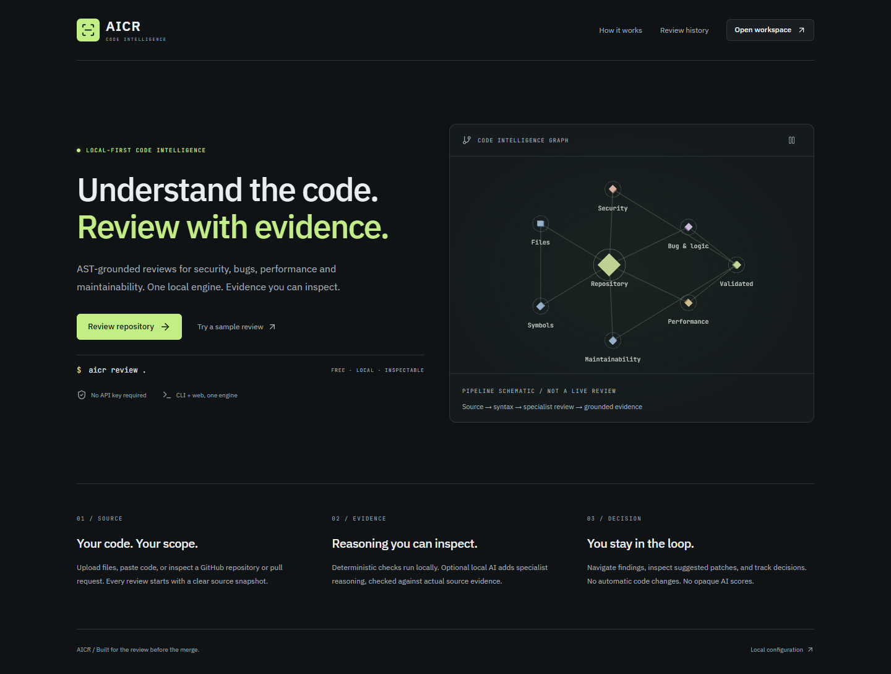
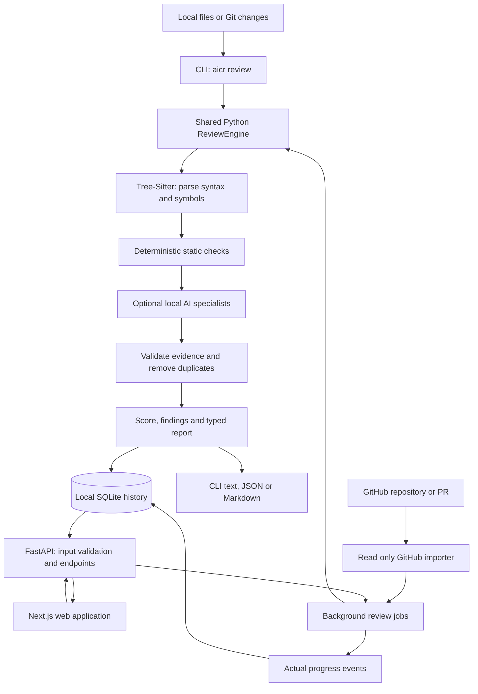
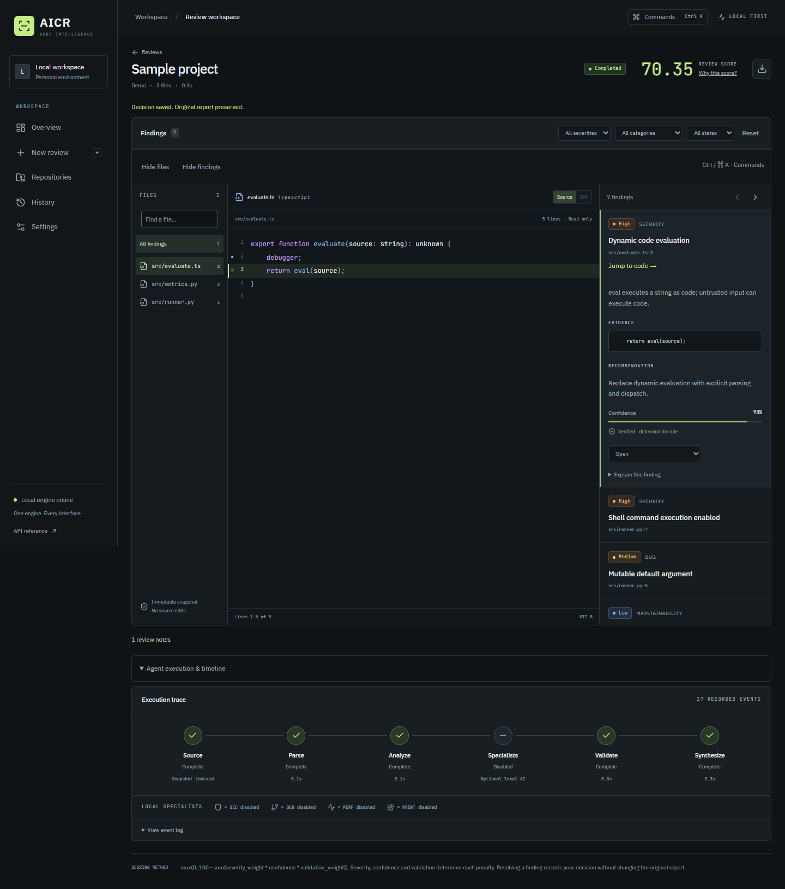

# AICR — AI Code Review System

**Understand the code. Review with evidence.**

AICR reviews Python, JavaScript and TypeScript through a web application or a command-line tool. It finds potential issues, points to the relevant source lines, explains the review score, and provides suggested patches where available.

**Free to run locally.** The default mode needs no API key, paid service, cloud account or AI model. Optional AI specialists use a model you run locally. Installation and GitHub imports require internet access; default local analysis works offline.

[Quick start](#quick-start) · [Architecture](#architecture) · [Demo walkthrough](#try-it-in-two-minutes) · [CLI](#command-line-usage) · [Tests](#tests-and-validation)



## What can it do?

- Review uploaded files, pasted code, a GitHub repository, a pull request, or an explicit demo project.
- Review a pasted unified diff when you also provide the complete resulting source file.
- Run AST parsing and deterministic checks; optionally add local security, bug, performance and maintainability specialists.
- Show actual pipeline progress, findings, evidence, confidence and score penalties.
- Navigate from a finding to its file and highlighted line; filter findings and record Open / Resolved / Ignored decisions.
- Inspect, copy and download suggested patches, export JSON, and revisit locally saved history.
- Use Ctrl/Cmd+K commands, collapsible desktop panels, mobile Code / Findings / Files views, and reduced-motion support.

## Architecture

**One review engine, two interfaces.** The CLI and the web API call the same Python engine. Review rules, validation and scoring are implemented once, so the same source and settings produce equivalent findings and scores.



### What each part does

| Part | Responsibility | Main location |
| --- | --- | --- |
| Web application | Collect input; display progress, code, findings and history | [`frontend/src`](frontend/src) |
| API | Validate requests and expose review operations; keep credentials server-side | [`api/`](backend/src/ai_code_review/api) |
| Job runner | Run reviews in the background; record progress and cancellation | [`jobs.py`](backend/src/ai_code_review/api/services/jobs.py) |
| Shared engine | Coordinate parsing, analysis, validation and scoring | [`engine.py`](backend/src/ai_code_review/review/engine.py) |
| AST and static rules | Read code structure and detect supported patterns without executing code | [`analysis/`](backend/src/ai_code_review/analysis) |
| Local AI adapters | Ask optional specialist reviewers for additional findings | [`agents/`](backend/src/ai_code_review/agents), [`llm/`](backend/src/ai_code_review/llm) |
| Storage | Persist reviews, findings, scores, events and user decisions | [`storage.py`](backend/src/ai_code_review/api/services/storage.py) |
| CLI | Normalize local/Git input and render the shared report | [`cli/`](backend/src/ai_code_review/cli) |

**AST explained:** an Abstract Syntax Tree represents code structure—such as functions, calls and expressions. AICR uses it to locate patterns and check reported evidence against the source. Matching evidence does not prove that an AI recommendation is correct.

### What happens when you click Start review?

1. The browser sends the selected source or GitHub URL to FastAPI.
2. The server validates the input and creates a queued review in SQLite.
3. A background worker prepares a source snapshot and calls the shared engine.
4. The engine parses the code, runs rules and optional AI, validates findings, and calculates penalties.
5. The browser polls persisted events and displays the actual state. Fast reviews finish immediately; animations add no delay.
6. The completed report remains in history. Selecting a finding opens its file and line; triage records your decision without changing the original score.

```text
Queued → Scanning → Parsing → Static analysis → Optional AI
       → Validating → Synthesizing → Completed

Alternative outcomes: Failed or Cancelled
```

The 3D Code Intelligence Graph illustrates this process. It is a labeled schematic, not a reconstructed repository call graph. It is lazy-loaded, pauses when hidden, and has a static fallback. It does not sit behind the code reader.

## Quick start

### Requirements

- Python **3.11+**
- Node.js **20.9+** and npm
- Git for cloning and Git-based CLI reviews
- Two terminal windows: one for the API, one for the web application

### 1. Clone the repository

```sh
git clone https://github.com/kailash0001/ai-code-review-system.git
cd ai-code-review-system
```

### 2. Install and start the backend

**Windows PowerShell:**

```powershell
py -3.11 -m venv .venv
.\.venv\Scripts\python.exe -m pip install -c backend/requirements-dev.lock -e "backend[web,dev]"
.\.venv\Scripts\aicr-api.exe
```

**Linux / macOS:**

```sh
python3 -m venv .venv
source .venv/bin/activate
python -m pip install -c backend/requirements-dev.lock -e "backend[web,dev]"
aicr-api
```

Leave that terminal running. The API listens at **http://127.0.0.1:8000**.

**Shortcut:** `scripts/run-backend.sh` (Linux/macOS) or `scripts\run-backend.bat` (Windows) does the setup above on first run, loads `.env` if you created one, and starts the API.

### 3. Start the frontend in a second terminal

From the repository root:

```sh
cd frontend
npm ci
npm run dev
```

**Shortcut:** `scripts/run-frontend.sh` (Linux/macOS) or `scripts\run-frontend.bat` (Windows).

Open **[http://127.0.0.1:3000](http://127.0.0.1:3000)**. No configuration file is required for the default local mode.

| Address | What you will see |
| --- | --- |
| [localhost:3000](http://127.0.0.1:3000) | Product introduction and demo entry point |
| [localhost:3000/app](http://127.0.0.1:3000/app) | Dashboard and saved reviews |
| [localhost:8000/docs](http://127.0.0.1:8000/docs) | Interactive API documentation |
| [localhost:8000/api/health](http://127.0.0.1:8000/api/health) | API health check |

For an optimized frontend, run `npm run build` followed by `npm start` instead of `npm run dev`. Stop either server with Ctrl+C.

## Try it in two minutes

1. Choose **Try a sample review**, then **Start review**. The sample contains deliberately unsafe code; the real engine analyzes it.
2. Select a finding and inspect its highlighted source, evidence, confidence and recommendation.
3. Select a finding with **View patch** to inspect, copy or download the suggested change.
4. Open **Why this score?** to see the actual penalty calculation.
5. Record a decision, try the filters, then open **History** or press **Ctrl/Cmd+K**.



## Command-line usage

After activating the Python environment, the same engine is available as `aicr`:

```sh
aicr doctor
aicr review . --no-ai
aicr review src/main.py
aicr review --staged
aicr review --diff HEAD~1
aicr review . --format json --output review.json
aicr review . --format markdown --output review.md
aicr review . --fail-on high
```

On Windows without environment activation, use `.\.venv\Scripts\aicr.exe` instead of `aicr`. Output files are never overwritten. Patches are suggestions; neither interface automatically changes your source.

Read the [CLI, scoring and local-AI reference](docs/usage_reference.md) for detailed options, validation states and the Python library interface.

## Technology stack

| Layer | Technologies |
| --- | --- |
| Review engine | Python, Tree-Sitter, Pydantic, built-in static rules |
| CLI | Typer, Rich |
| API and storage | FastAPI, Uvicorn, HTTPX, SQLite |
| Web application | Next.js, React, TypeScript, Tailwind CSS |
| Data and UI | TanStack Query, Zod, Radix Dialog, Prism |
| Motion and 3D | Motion for React, Three.js, React Three Fiber |
| Quality checks | pytest, Ruff, mypy, Vitest, Playwright, axe-core |

## Repository map

```text
ai-code-review-system/
├── backend/
│   ├── src/ai_code_review/
│   │   ├── core/           # Settings, report models and progress contracts
│   │   ├── review/         # Shared engine, inputs, validation and scoring
│   │   ├── analysis/       # AST parsing and static rules
│   │   ├── agents/         # Optional specialist coordination
│   │   ├── llm/            # Local model adapters
│   │   ├── integrations/   # Read-only GitHub imports
│   │   ├── api/            # HTTP routes, jobs and SQLite storage
│   │   └── cli/            # Terminal commands and report rendering
│   └── tests/
├── frontend/
│   ├── src/app/            # Landing, dashboard and review routes
│   ├── src/components/     # Source viewer, findings, graph and commands
│   ├── src/lib/            # API client, types, preferences and motion tokens
│   ├── tests/              # Component and API-state tests
│   └── e2e/                # Real browser journeys and CLI parity
├── docs/                   # Architecture, design, validation and screenshots
├── scripts/                # Optional live GitHub smoke test and research tools
└── .github/workflows/      # Automated quality checks
```

## Configuration and data handling

Defaults are ready for local use. Backend variables must be exported in the API terminal; the API does **not** automatically read `.env`. The CLI accepts an explicit `--env-file`. Frontend overrides can go in `frontend/.env.local`.

| Variable | Default / purpose |
| --- | --- |
| `AICR_PROVIDER` | `none`; optional `ollama` or `openai-compatible` local server |
| `AICR_BASE_URL`, `AICR_MODEL` | Local model endpoint and installed model name |
| `AICR_API_KEY` | Only for NVIDIA: `AICR_PROVIDER=openai-compatible`, `AICR_BASE_URL=https://integrate.api.nvidia.com/v1`, `AICR_MODEL=<id from build.nvidia.com>`. Copy `.env.example` to `.env`; the run-backend scripts load it. Code is sent to NVIDIA. |
| `AICR_WEB_GITHUB_TOKEN` | Optional server-only GitHub token; public imports work without it, subject to rate limits |
| `AICR_WEB_DATA_DIR` | `.aicr/web`, containing local SQLite history |
| `AICR_WEB_SOURCE_RETENTION_HOURS` | Full source snapshots expire after 24 hours |
| `AICR_WEB_MAX_FILES` | Up to 100 uploaded files |
| `AICR_WEB_MAX_SOURCE_BYTES` | 2 MB combined source; each file at most 500 KB |
| `AICR_WEB_GITHUB_MAX_FILES` | Up to 30 supported GitHub source files; partial scope is reported |
| `NEXT_PUBLIC_API_URL` | `http://127.0.0.1:8000` |

See [.env.example](.env.example) and [frontend/.env.example](frontend/.env.example). Never use a `NEXT_PUBLIC_` variable for tokens.

Repository code is treated as untrusted data and is never executed. Optional model prompts separate repository content from system instructions. GitHub imports use read-only requests; the application does not post comments or commits. Full snapshots expire, but report evidence and patches remain until you delete the review from history.

This release is a **single-user local application**. Keep the default loopback addresses and ports. Public hosting requires authentication, authorization and deployment hardening.

## Tests and validation

With the Python environment activated, run from the repository root:

```sh
python -m pytest backend/tests -q
python -m ruff check backend
python -m ruff format --check backend
python -m mypy --config-file backend/pyproject.toml backend/src
```

From `frontend`:

```sh
npm run lint
npm run typecheck
npm test
npm run build
npm run test:e2e
```

Browser tests use installed Microsoft Edge on Windows. On Linux, install Chromium with `npx playwright install --with-deps chromium` and run with `CI=1`. Tests can start their own local API and production frontend; use free ports 8000 and 3000 for an isolated run.

Local validation: **100 backend tests passed, 7 frontend tests passed, and all 6 browser journeys passed**. One backend test was skipped for Windows symlink permissions. Browser coverage includes exact CLI/web findings and score parity, patch copying/downloading, keyboard use, mobile layouts, reduced motion, fallback, errors and accessibility checks. See the [validation report](docs/product_validation.md) for scope and limitations; local results are distinct from GitHub Actions results.

### Troubleshooting

| Problem | First check |
| --- | --- |
| Engine unavailable in the browser | Start `aicr-api`; open `/api/health` on port 8000 |
| `aicr` command not found | Activate `.venv`, or use its full executable path |
| `npm start` says no production build | Run `npm run build`, or use `npm run dev` |
| AI specialists are disabled | Expected by default; configure an installed local model to enable them |
| GitHub import denied | Check repository access, server token and GitHub rate limits |
| No full source snapshot | It may have expired; the saved report still contains cited evidence |

## Limits and next steps

Python has the broadest rule coverage; JavaScript/TypeScript support is narrower. These are review heuristics, not a replacement for tests or a comprehensive security scanner. A score of 100 can mean no matching rules or no supported files—read the review warnings. Local AI quality depends on the model and has not been benchmarked here.

Future work includes deeper analysis, more languages, actual repository symbol topology, a GitHub App/webhooks, multiuser authentication and approved patch application.

## Further reading

- [Core architecture and contracts](docs/phase1_architecture.md)
- [CLI, scoring and local AI](docs/usage_reference.md)
- [UI/UX and performance design](docs/product_design.md)
- [Validation and known limitations](docs/product_validation.md)
- [Original repository audit](docs/repository_audit.md)
- [Historical research proposal](docs/code_review_system_technical_documentation.md)

The original research presentation in `public/index.html` and proposal documents are preserved as historical material. Their proposed capabilities and unverified benchmark claims are not current product results.
