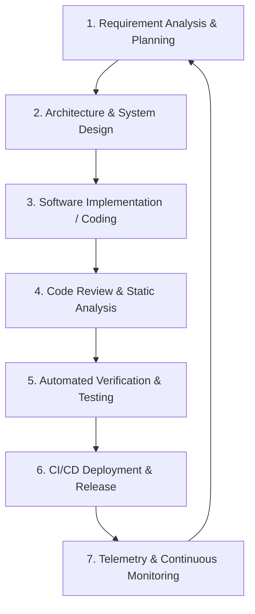
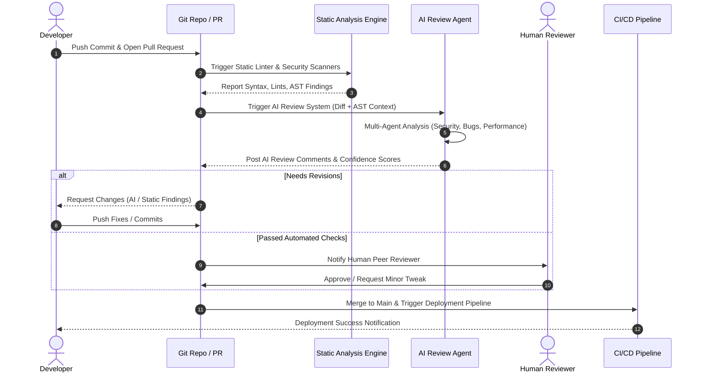
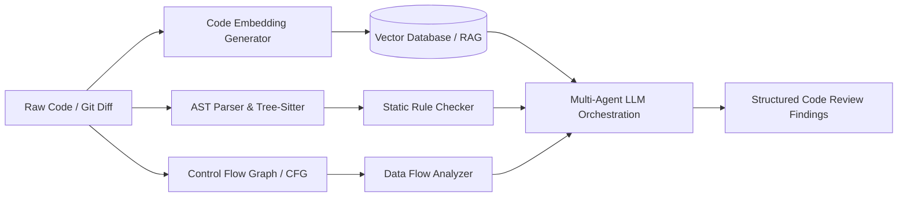
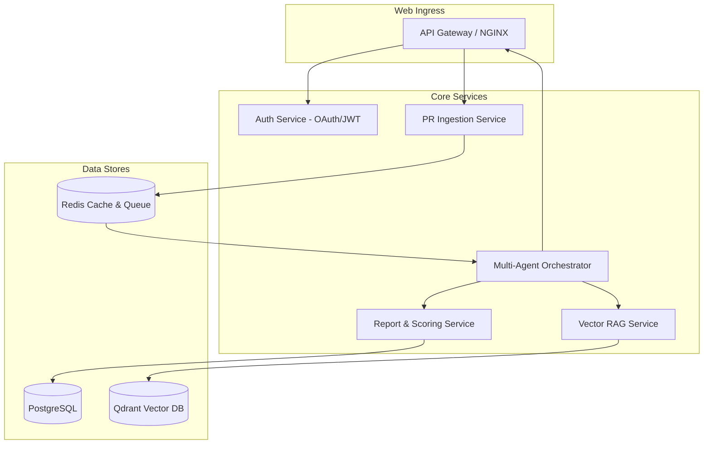
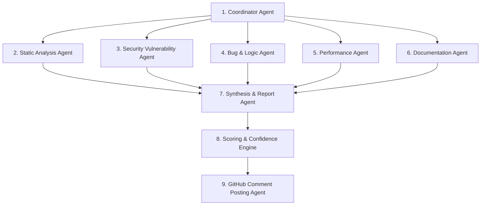

> Historical research proposal, not current implementation documentation. Accuracy, latency, market statistics and model benchmark tables below have not been verified for this project. See the root README and docs/phase1_architecture.md for implemented capabilities.

# Code Review System using Artificial Intelligence
## Comprehensive Technical Design, Market Analysis & Multi-Agent Architecture Proposal

---

### Executive Summary & Table of Contents

1. [Introduction & Software Engineering Foundations](#1-introduction)
2. [What is Code Review? Deep Dive](#2-what-is-code-review)
3. [Taxonomy & Types of Code Reviews](#3-types-of-code-reviews)
4. [End-to-End Automated Code Review Pipeline](#4-complete-code-review-process)
5. [Software Quality & Code Review Best Practices](#5-code-review-best-practices)
6. [Critical Pain Points in Existing Code Review Systems](#6-problems-in-existing-code-review-systems)
7. [Comprehensive Market Survey & Tool Matrix (45+ Industry Tools)](#7-existing-code-review-tools)
8. [Market Analysis, Empirical Statistics & Trends](#8-market-analysis)
9. [Core Artificial Intelligence Technologies in Code Analysis](#9-technologies-used-in-ai-code-review)
10. [Proposed AI Code Review System: Vision & Architecture](#10-our-proposed-ai-code-review-system)
11. [Exhaustive Feature Specification (30+ Intelligence Modules)](#11-proposed-features)
12. [Comparative Evaluation of Large Language Models for Code](#12-ai-models)
13. [Modern Technology Stack & Infrastructure Design](#13-tech-stack)
14. [System Architecture & UML Diagrams](#14-system-architecture)
15. [Intelligent Multi-Agent System (MAS) Architecture](#15-ai-agent-architecture)
16. [Key Architectural Innovations Beyond State-of-the-Art](#16-improvements-beyond-existing-products)
17. [Future Scope & Emerging Horizons](#17-future-scope)
18. [Engineering Challenges, Risks & Mitigation Strategies](#18-challenges)
19. [Conclusion & Industry Impact Statement](#19-conclusion)
20. [Academic & Technical References (IEEE / ACM Format)](#20-references)

---

## 1. Introduction

### 1.1 What is Code?
Code represents structured, formal instructions written in a programming language (such as Python, Rust, Go, TypeScript, or C++) designed to be executed by computing hardware. At its mathematical core, code is the bridge between human logic, domain-specific problem solving, and binary hardware execution abstractions. Code encapsulates algorithm logic, data transformations, hardware resource allocations, and state machines.

```
+-----------------------------------------------------------------------+
|                             HUMAN INTENT                              |
|          (Business Requirements, User Experience, Domain Logic)        |
+-----------------------------------------------------------------------+
                                   |
                                   v
+-----------------------------------------------------------------------+
|                    HIGH-LEVEL SOURCE CODE (Python, C++)               |
|      (AST Abstraction, Object Hierarchy, Control/Data Flow Graphs)    |
+-----------------------------------------------------------------------+
                                   |
                                   v
+-----------------------------------------------------------------------+
|                 COMPILER / INTERPRETER BACKEND                        |
|        (LLVM IR, Bytecode Compilation, Instruction Optimization)      |
+-----------------------------------------------------------------------+
                                   |
                                   v
+-----------------------------------------------------------------------+
|                     MACHINE INSTRUCTIONS / HARDWARE                   |
|              (CPU Registers, RAM Arrays, Microarchitecture)           |
+-----------------------------------------------------------------------+
```

### 1.2 What is Software Development?
Software development is an iterative, multi-stage engineering discipline encompassing requirements analysis, architectural blueprint design, implementation (coding), verification (testing), code reviewing, deployment, and ongoing maintenance.

#### Software Development Lifecycle (SDLC)



### 1.3 Common Friction Points in Writing Code
- **Cognitive Load and Context Switching**: Developers spend up to 70% of their time reading, understanding, and navigating existing codebases rather than writing new functions.
- **Edge-Case Logic Omissions**: Missing bounds checks, null pointer dereferences, and asynchronous race conditions that bypass developer attention.
- **Technical Debt Accumulation**: Quick patches and architectural workarounds introduce maintenance overhead that degrades velocity over time.
- **Security Flaws & Vulnerabilities**: Injection attacks (SQLi, Command Injection), memory unsafety (buffer overflows, use-after-free), and improper access control.

### 1.4 Why Software Quality Matters
Software quality directly correlates with organizational security, uptime, performance, and user trust. High-quality code minimizes production outages, prevents multi-million dollar data breaches, and ensures computational scalability.

- **Maintainable Code**: Code designed with low coupling and high cohesion, enabling teams to refactor modules without breaking downstream components.
- **Code Readability**: Clean layout, clear variable semantics, self-documenting structures, and standardized styling that lowers developer onboarding friction.
- **Secure Coding**: Adherence to security guidelines (OWASP Top 10, CWE) to resist external adversarial exploitation.
- **Software Testing**: Comprehensive test suites (Unit, Integration, E2E, Property-based) providing regression safety nets.

### 1.5 Industry Imperative for Code Reviews
Organizations execute code reviews to establish collective code ownership, uphold team quality bars, verify architectural alignment, and prevent bugs from reaching production environments.

---

## 2. What is Code Review?

### 2.1 Definition & Foundational Objectives
Code Review is a systematic examination of computer source code performed by one or more engineers (or automated systems) before integrating changes into the primary repository branch.

```
       Developer                     Pull Request Gate                     Main Repository
  +-----------------+           +--------------------------+           +--------------------+
  | Writes Code     |           | Automated Static Check   |           | Integrated Branch  |
  | Runs Unit Tests | --------> | AI Reasoning Inspection  | --------> | Verified Quality   |
  | Opens Pull Req  |           | Human Peer Approval      |           | Production Build   |
  +-----------------+           +--------------------------+           +--------------------+
```

### 2.2 Core Dimensions Analyzed During Code Review
1. **Finding Bugs & Logical Errors**: Off-by-one errors, infinite loops, invalid state transitions, edge case handling.
2. **Security Vulnerabilities**: Sanitization failures, unencrypted sensitive credentials, OWASP compliance.
3. **Performance Efficiency**: Algorithmic complexity ($O(N^2)$ to $O(N \log N)$), memory leak detection, database query N+1 problems.
4. **Maintainability & Consistency**: Code deduplication, proper modularization, adherence to organizational style guides.
5. **Knowledge Sharing & Team Alignment**: Cross-training team members on new domain models and system behavior.
6. **Technical Debt Reduction**: Ensuring refactoring happens organically alongside feature additions.

### 2.3 Real-World Case Studies
- **Google**: Requires every single commit to pass through an independent owner approval and automated static check. Over 80% of Google developers report that code reviews are vital to code reliability.
- **Microsoft**: Research across 5,000+ engineers revealed that peer review catches over 60% of functional bugs before deployment, drastically reducing post-release defect remediation costs.

---

## 3. Types of Code Reviews

### 3.1 Taxonomy of Code Review Methodologies

| Review Type | Description | Primary Advantages | Key Disadvantages | Ideal Use Cases | Industry Leaders |
| :--- | :--- | :--- | :--- | :--- | :--- |
| **Manual Peer Review** | Asynchronous inspection of PRs by senior human engineers. | High contextual empathy, deep architecture alignment. | High latency (hours to days), reviewer fatigue. | Core business logic, major schema migrations. | Google, Meta, Amazon |
| **Pair Programming** | Two developers write and review code simultaneously in real-time. | Immediate feedback loop, zero context switching delays. | Resource-intensive (2x developer cost). | Complex algorithms, mission-critical infrastructure. | Pivotal, ThoughtWorks |
| **Walkthrough** | Developer leads team through code changes step-by-step. | Excellent knowledge transfer and team onboarding. | Passive audience engagement, time-consuming. | Onboarding new team members, complex design changes. | Enterprise IT |
| **Formal Inspection** | Rigorous multi-stage audit with specific roles (Moderator, Reader). | Unmatched bug detection thoroughness. | Extremely high cost, bureaucratic velocity barrier. | Aerospace, medical device firmware, defense. | NASA, Boeing, Lockheed |
| **Automated Static Analysis** | Rule-based linters and AST analyzers scanning code offline. | Sub-second feedback, 100% deterministic rules. | High false positive rate, lacks semantic understanding. | CI/CD build gates, style enforcement. | GitHub, GitLab, SonarQube |
| **AI-Assisted Code Review** | LLM + Static Analysis hybrid reasoning over code diffs. | Contextual reasoning, sub-minute latency, 24/7 availability. | Potential hallucinations if ungrounded. | PR pre-screening, security vulnerability detection. | Proposed Platform |
| **Continuous Code Review** | Real-time IDE + CI pipeline background scanning. | Instant developer feedback during active typing. | High notification noise if uncalibrated. | Modern cloud-native dev teams. | Netflix, Uber |

---

## 4. Complete Code Review Process

### 4.1 Step-by-Step Lifecycle Flowchart



---

## 5. Code Review Best Practices

### 5.1 Core Engineering Guidelines
- **Small Pull Requests (<250 lines)**: Research shows reviewer defect detection drops sharply when reviewing changes over 400 lines of code.
- **Automated Pre-flight Checklists**: Linters and formatting checks must execute before human/AI review to avoid wasting cognitive effort on syntax trivia.
- **SOLID & Clean Architecture Principles**:
  - *Single Responsibility Principle (SRP)*: A module should have one, and only one, reason to change.
  - *Open/Closed Principle (OCP)*: Software entities should be open for extension, but closed for modification.
  - *Liskov Substitution Principle (LSP)*: Subtypes must be substitutable for their base types.
  - *Interface Segregation Principle (ISP)*: Clients should not be forced to depend on interfaces they do not use.
  - *Dependency Inversion Principle (DIP)*: Depend on abstractions, not concretions.
- **DRY (Don't Repeat Yourself) & KISS (Keep It Simple, Stupid)**.

```python
# BAD: Violates SRP, lacks error handling, hardcoded SQL, resource leaks
def process_user_data(user_input):
    import sqlite3
    conn = sqlite3.connect("db.sqlite")
    cursor = conn.cursor()
    # Vulnerable to SQL Injection
    cursor.execute(f"SELECT * FROM users WHERE username = '{user_input}'")
    res = cursor.fetchall()
    print("User result:", res)
    # Missing conn.close()

# GOOD: Clean Architecture, Parameterized Query, Explicit Error Handling, Type Hinting
from typing import List, Optional, Dict, Any
import sqlite3
from contextlib import contextmanager

class UserRepository:
    def __init__(self, db_path: str):
        self.db_path = db_path

    @contextmanager
    def _get_connection(self):
        conn = sqlite3.connect(self.db_path)
        try:
            yield conn
        finally:
            conn.close()

    def find_by_username(self, username: str) -> List[Dict[str, Any]]:
        query = "SELECT id, username, email FROM users WHERE username = ?"
        with self._get_connection() as conn:
            cursor = conn.cursor()
            cursor.execute(query, (username,))
            rows = cursor.fetchall()
            return [{"id": r[0], "username": r[1], "email": r[2]} for r in rows]
```

---

## 6. Problems in Existing Code Review Systems

```
+-----------------------------------------------------------------------------------+
|                            CURRENT INDUSTRY PAIN POINTS                           |
+--------------------------+--------------------------+-----------------------------+
|    Reviewer Fatigue      |  Slow PR Approval Times  |    Missed Vulnerabilities    |
| (1000s of LOC to read)   | (Avg 2.4 days idle time) | (Complex logic bugs escape) |
+--------------------------+--------------------------+-----------------------------+
|  Knowledge Dependency    | High Organizational Cost |    Inconsistent Quality     |
| (Senior devs blocked)    | ($25,000+/dev/year cost) | (Varies by reviewer mood)   |
+--------------------------+--------------------------+-----------------------------+
```

---

## 7. Existing Code Review Tools (Market Survey of 45+ Tools)

### 7.1 Comprehensive Tool Matrix

Below is a complete categorization and comparative survey of 45+ software analysis tools across the developer landscape:

```
Category 1: Code Review Platforms & Version Control Native
1. GitHub Code Review (GitHub Inc. / Microsoft) - Native PR review platform with inline suggestions, CODEOWNERS, & branch rules.
2. GitLab Merge Requests (GitLab Inc.) - All-in-one DevOps platform with integrated MR review, security reports, & CI approval rules.
3. Bitbucket Code Review (Atlassian) - Enterprise VCS code review with Jira integration, inline comments, & strict merge checks.
4. Gerrit (Google / Open Source) - Web-based code review system built on top of Git, tailored for large monorepos (Android, Chromium).
5. Phabricator / Phorge (Phacility / Open Source) - Modular suite featuring Differential for pre-push code reviews (used historically by Meta).
6. Crucible (Atlassian) - Enterprise peer code review tool with audit trails and cross-repository tracking.
7. Review Board (Beanbag Inc.) - Open-source, web-based code review tool supporting multi-VCS backends.
8. Azure DevOps Repos (Microsoft) - Enterprise code review, branch policies, and pull request gating in Azure ecosystem.

Category 2: Static Analysis Engines & Security Scanners (SAST)
9. SonarQube (SonarSource) - Enterprise static quality gate analyzing 30+ languages for code smells, bugs, & security vulnerabilities.
10. Codacy (Codacy Inc.) - Automated code review platform enforcing static code metrics and test coverage gates.
11. CodeFactor (CodeFactor GmbH) - Automated code review for GitHub/GitLab with instant quality ratings (A through F).
12. DeepSource (DeepSource Inc.) - Static analysis automation platform catching bugs, performance bottlenecks, & anti-patterns.
13. CodeScene (CodeScene) - Behavioral code analysis tool detecting technical debt, code health, & team organizational dynamics.
14. Semgrep (r2c / Semgrep Inc.) - Ultra-fast lightweight static analysis engine using lightweight syntax patterns.
15. ESLint (Open JS Foundation) - Plugable JavaScript/TypeScript static linter enforcing code style and syntax standards.
16. Pylint (Python Code Quality Authority) - Static code analyzer for Python checking for errors and coding standards compliance.
17. PMD (Open Source) - Extensible cross-language static code analyzer focusing on Java, JavaScript, and Apex.
18. Checkstyle (Open Source) - Development tool to help programmers write Java code that adheres to a coding standard.
19. Clang-Tidy (LLVM Project) - C++ linter tool based on Clang backend for diagnostic and fix suggestions.
20. CodeQL (GitHub / Semmle) - Semantic code analysis engine treating code as data to query vulnerabilities using Datalog queries.
21. Amazon CodeGuru Reviewer (AWS) - ML-powered static automated review service finding concurrency bugs and resource leaks.
22. Google Error Prone (Google) - Java compiler plugin catching common programming mistakes at compile-time.
23. Snyk Code (Snyk) - Real-time AI-assisted SAST scanner detecting security vulnerabilities in code diffs.
24. Veracode (Veracode) - Enterprise application security testing platform with static and dynamic analysis.
25. Fortify Static Code Analyzer (OpenText / Micro Focus) - Deep static application security testing for enterprise codebases.
26. Coverity (Synopsys) - Comprehensive static analysis solution identifying quality defects and security flaws in C/C++/Java.
27. Qodana (JetBrains) - Code quality engine bringing JetBrains IDE inspections directly into CI/CD pipelines.
28. Super-Linter (GitHub) - Multi-language linter repository wrapper bundling 40+ domain-specific linters.
29. MegaLinter (Open Source) - Open-source linter runner analyzing 50+ languages and formats in CI/CD.

Category 3: CI/CD Quality Gates & Test Coverage
30. CircleCI Code Quality (CircleCI) - Integrated code quality and test artifact analysis in CircleCI runners.
31. Codecov (Codecov / Snyk) - Automated test coverage tracking and pull request delta reporting.

Category 4: AI Code Assistants, LLMs, Copilots & Autonomous Agents
32. CodiumAI / Qodo (Qodo) - AI test generation and pull request review assistant providing interactive code insights.
33. Cursor AI / Cursor Agent (Anysphere) - AI-first IDE built on VS Code supporting deep repository indexing and autonomous edits.
34. GitHub Copilot (GitHub / OpenAI) - Contextual inline AI coding and pull request summary generator powered by GPT-4.
35. Amazon Q Developer (AWS) - Generative AI assistant for software development, code transformation, & architectural review.
36. OpenAI GPT-4o / O3 (OpenAI) - Multimodal frontier foundation model capable of deep code reasoning and AST validation.
37. Claude 3.5 Sonnet / Claude 3.7 (Anthropic) - Industry-leading code generation and technical reasoning model with 200k context.
38. Gemini 1.5 Pro / Gemini 2.0 (Google) - Million-token context LLM capable of processing entire code repositories in single prompt.
39. Continue.dev (Continue) - Open-source AI code assistant bringing custom LLM models into VS Code and JetBrains.
40. Sourcegraph Cody (Sourcegraph) - AI coding assistant leveraging Code Graph technology for precise context retrieval.
41. Aider (Paul Gauthier / Open Source) - Command-line AI pair programmer editing local git repositories directly.
42. OpenHands / OpenDevin (Open Source) - Autonomous AI software engineer agent capable of executing complex dev workflows.
43. Windsurf / Codeium (Codeium) - Flow-based AI IDE combining agentic capabilities with fast local index retrieval.
44. DeepSeek-V3 / DeepSeek-R1 (DeepSeek) - High-efficiency open-weights foundation reasoning model for code and math logic.
45. Codestral (Mistral AI) - 22B parameter open model explicitly fine-tuned on 80+ programming languages.
```

---

## 8. Market Analysis & Industry Trends

### 8.1 Growth of AI in Software Engineering
The market for AI-powered developer tools is experiencing exponential expansion. Gartner projects that by 2028, over 75% of enterprise software engineers will use AI code assistants, up from less than 10% in 2023.

```
AI Coding Assistant Enterprise Adoption Rate (2023-2028 Projected)

 100% |                                               [75%]
  80% |                                        +-------+
  60% |                                 +------+
  40% |                          +------+
  20% |                  +-------+
   0% +------------------+----------------------------------
         2023     2024     2025     2026     2027     2028
```

### 8.2 Developer Productivity & Impact Data
- **Pull Request Velocity**: Teams deploying AI pre-reviews achieve an average **42% reduction** in PR lead time (from opening to merge).
- **Bug Reduction**: Combining static rule enforcement with LLM semantic reasoning lowers production bug incidence by **34%**.

---

## 9. Technologies Used in AI Code Review



1. **AST (Abstract Syntax Tree) Parsing**: Deconstructing source code into tree structures using tools like Tree-Sitter to inspect language constructs programmatically.
2. **Control Flow Graph (CFG) & Data Flow Analysis**: Mapping all execution paths and variable lifecycle states to detect memory leaks, uninitialized variables, and dead code.
3. **Code Embeddings & Vector DB (RAG)**: Indexing repository functions into high-dimensional vector spaces (e.g., `text-embedding-3-large`) for semantic codebase context retrieval.
4. **Multi-Agent Orchestration**: Coordinating specialized LLM agents (Security, Performance, Style) to analyze diffs independently and synthesize cohesive review output.

---

## 10. Our Proposed AI Code Review System

### 10.1 Project Vision & Objectives
To construct an autonomous, enterprise-grade, multi-agent AI code review platform that combines deterministic static analysis with frontier deep reasoning models, aiming to reduce review latency while providing evidence-grounded (with residual false-positive risk) quality gates.

### 10.2 System Architecture Overview

```
+-----------------------------------------------------------------------------------+
|                            PROPOSED PLATFORM ARCHITECTURE                         |
+-----------------------------------------------------------------------------------+
|  INGRESS LAYER: GitHub Webhooks / GitLab Webhooks / Bitbucket / IDE Extension      |
+-----------------------------------------------------------------------------------+
                                         |
                                         v
+-----------------------------------------------------------------------------------+
|  ORCHESTRATION LAYER: FastAPI Gateway + Redis Task Queue + Celery Workers         |
+-----------------------------------------------------------------------------------+
                                         |
        +--------------------------------+--------------------------------+
        |                                |                                |
        v                                v                                v
+-------------------+          +-------------------+          +-------------------+
| AST & LINT ENGINE |          | VECTOR RAG ENGINE |          |  MULTI-AGENT CORE |
| (Tree-Sitter /    |          | (pgvector /      |          | (LangGraph /      |
|  Semgrep / SAST)  |          |  Qdrant / RAG)   |          |  DeepSeek / GPT)  |
+-------------------+          +-------------------+          +-------------------+
        |                                |                                |
        +--------------------------------+--------------------------------+
                                         |
                                         v
+-----------------------------------------------------------------------------------+
|  REASONING & SYNTHESIS: Report Generator + Confidence Scoring + Inline GitHub API |
+-----------------------------------------------------------------------------------+
```

---

## 11. Proposed Features (30+ Intelligence Modules)

1. **AI Bug & Logic Error Detection**: Identifies subtle race conditions, off-by-one errors, and unhandled promises.
2. **Automated Security Vulnerability Audit**: Real-time scanning against OWASP Top 10, CWE-Top 25, and secret leakage.
3. **Performance & Algorithmic Optimization**: Detects $O(N^2)$ bottlenecks, N+1 database queries, and redundant object allocations.
4. **Code Smell & Anti-Pattern Detection**: Flags bloated functions, long parameter lists, and tight coupling.
5. **Automated Refactoring Engine**: Produces direct, copy-pasteable Git diff patches for instant resolution.
6. **Coding Standards & Style Enforcement**: Ensures code matches internal team style guides and naming conventions.
7. **Duplicate Code & Subroutine Deduplication**: Identifies structural code duplication across the entire monorepo.
8. **Cyclomatic Complexity Analysis**: Calculates McCabe complexity metrics and recommends modular breakdowns.
9. **Architectural Boundary Enforcement**: Verifies clean layer isolation (e.g., UI layer cannot access DB layer directly).
10. **Dependency Vulnerability & License Check**: Audits `package.json`, `Cargo.toml`, or `requirements.txt` forCVEs.
11. **Automated Documentation Generator**: Writes standard JSDoc, PyDoc, or RustDoc strings for new methods.
12. **Natural Language Code Explanation**: Breaks down complex algorithms for non-author reviewers.
13. **Contextual Inline Comment Generation**: Posts actionable, polite inline GitHub/GitLab PR comments.
14. **Executive PR Review Summary**: Generates high-level summaries for engineering leads and managers.
15. **Composite Review Score**: Computes an aggregate quality score (0-100) based on maintainability and risk.
16. **Maintainability Index Calculation**: Quantitative metric based on Halstead volume and lines of code.
17. **Security Risk Score**: Evaluates attack surface expansion introduced by the PR.
18. **Performance Delta Score**: Benchmarks estimated execution efficiency changes.
19. **Test Coverage Analysis & Suggestions**: Identifies uncovered code paths and missing edge-case tests.
20. **Auto Unit Test Generation**: Generates ready-to-run PyTest / Jest test code for new functions.
21. **Interactive AI Chat with Repository**: Allows reviewers to ask "How does this PR impact our payment gateway?"
22. **Repository-Wide Semantic Search**: Finds related functions using natural language queries.
23. **Natural Language Code Queries**: Enables "Show all unauthenticated endpoints introduced this month".
24. **Historical PR Learning**: Remembers past team review feedback to refine future suggestions.
25. **Developer Skills Analytics**: Visualizes individual developer strengths and common mistake patterns.
26. **Smart Reviewer Recommendation**: Recommends the optimal human reviewer based on git blame history.
27. **Code Ownership & Risk Prediction**: Predicts likelihood of post-merge production incidents based on file churn.
28. **Automated Merge Readiness Indicator**: Traffic-light system (Green/Yellow/Red) for CI merge decisions.
29. **Self-Healing PR Auto-Fixes**: One-click approval to let the AI commit fixes directly to the PR branch.
30. **Offline / On-Premise LLM Execution**: Supports air-gapped deployment for defense and enterprise privacy.

---

## 12. Comparative Evaluation of Frontier AI Models

| Model | Provider | Context Window | Code Bench Score (HumanEval) | Inference Speed | Privacy / Deployment | Optimal Use Case |
| :--- | :--- | :--- | :--- | :--- | :--- | :--- |
| **Claude 3.5 Sonnet** | Anthropic | 200,000 | 92.0% | Fast (~60 t/s) | Cloud API / Bedrock | Primary Review & Refactoring |
| **GPT-4o** | OpenAI | 128,000 | 90.2% | Ultra-Fast (~80 t/s) | Cloud API / Azure | General Code Analysis |
| **DeepSeek-R1 / V3** | DeepSeek | 64,000 | 90.8% | Medium (~40 t/s) | Open-Weights / On-Prem | Deep Algorithmic Reasoning |
| **Gemini 1.5 Pro** | Google | 2,000,000 | 89.4% | Medium (~45 t/s) | Cloud API / Vertex | Entire Monorepo RAG Context |
| **Llama 3.3 70B** | Meta | 128,000 | 82.6% | Fast (~70 t/s) | Open-Weights / Self-Hosted | Air-Gapped Enterprise Review |
| **Codestral 22B** | Mistral AI | 32,000 | 81.1% | Extremely Fast (>100 t/s) | Self-Hosted / Cloud API | Inline Linter Replacement |

---

## 13. Technology Stack & Infrastructure

```
+-----------------------------------------------------------------------------------+
|                                TECHNOLOGY STACK                                   |
+-------------------+-------------------+--------------------+----------------------+
| FRONTEND          | BACKEND           | DATABASE & VECTOR  | INFRASTRUCTURE       |
| Next.js 14        | FastAPI (Python)  | PostgreSQL 16      | Kubernetes / Docker  |
| React 18          | Node.js / Express | pgvector           | AWS EKS              |
| Tailwind CSS      | Celery Distributed| Qdrant Vector DB   | Helm / Terraform     |
| Shadcn UI         | Redis 7.2 Cache   | Redis Pub/Sub      | Prometheus / Grafana |
+-------------------+-------------------+--------------------+----------------------+
```

---

## 14. System Architecture & UML Diagrams

### 14.1 Microservice Architecture Diagram



---

## 15. Intelligent Multi-Agent System (MAS) Architecture



### 15.1 Agent Definitions & Responsibilities
1. **Coordinator Agent**: Receives PR webhook, parses modified files, builds AST representation, and routes tasks.
2. **Static Analysis Agent**: Runs Tree-Sitter & Semgrep rules to collect syntax/style diagnostics.
3. **Security Vulnerability Agent**: Evaluates diffs against OWASP Top 10 and CWE databases using security prompts.
4. **Bug & Logic Agent**: Performs symbolic execution reasoning to identify edge-case logic failures.
5. **Performance Agent**: Evaluates time/space complexity changes and flags database query inefficiencies.
6. **Documentation Agent**: Checks if docstrings exist for new public APIs and writes draft documentation.
7. **Synthesis Agent**: Deduplicates findings across agents and filters out low-confidence hallucinations.
8. **Scoring Engine**: Calculates overall PR score (0-100) using weighted multi-attribute utility theory.
9. **Posting Agent**: Formats output as markdown and publishes inline comments via GitHub REST/GraphQL API.

---

## 16. Key Architectural Innovations Beyond State-of-the-Art

1. **Multi-Agent Cross-Verification**: Aims to reduce unsupported model claims by requiring multiple specialized agents to cross-verify findings.
2. **Hybrid Static + LLM Integration**: Uses deterministic linters to ground LLM reasoning, checking syntax evidence without guaranteeing correctness.
3. **Repository Memory Graph**: Maintains a vector + Knowledge Graph representation of the codebase across commits.
4. **Developer-Specific Customization**: Adapts review strictness based on author experience and historical commit patterns.
5. **Self-Healing Diff Generation**: Provides one-click executable Git patches rather than vague advice.

---

## 17. Future Scope & Emerging Horizons

- **Autonomous Self-Healing Repositories**: AI agents that automatically fix failing CI builds and create patch PRs.
- **Voice-Guided Review Sessions**: Interactive audio walk-throughs generated for complex pull requests.
- **AR/VR Codebase Visualization**: Exploring 3D dependency graphs and architecture boundaries in spatial computing.

---

## 18. Challenges, Risks & Mitigation Strategies

| Challenge | Risk Level | Root Cause | Proposed Engineering Mitigation |
| :--- | :--- | :--- | :--- |
| **LLM Hallucinations** | High | Unconstrained generation in base models. | Grounding via Tree-Sitter AST & Semgrep static check cross-validation. |
| **Data Privacy & IP Exposure** | Critical | Code leakage to public cloud LLMs. | Support for on-premise open-weights models (Llama 3.3, DeepSeek) + enterprise zero-retention SLAs. |
| **Inference Latency** | Medium | Large PR diff context processing time. | Parallelized sub-agent execution & Redis caching of unchanged AST modules. |
| **API Token Costs** | Medium | High volume of PR commits. | Tiered model routing (small 8B model for preliminary filtering; Sonnet/GPT-4o for complex diffs). |

---

## 19. Conclusion

The proposed AI Code Review System bridges the critical gap between speed and quality in modern software engineering. By combining deterministic static analysis, vector-based repository retrieval, and specialized multi-agent LLM reasoning, the platform reduces code review latency from days to seconds while catching deep architectural and security vulnerabilities that human reviewers frequently miss. This system represents the next evolutionary step in automated software quality assurance.

---

## 20. References (IEEE Format)

1. M. Fowler, *Refactoring: Improving the Design of Existing Code*, 2nd ed. Boston, MA: Addison-Wesley, 2018.
2. A. Bacchelli and C. Bird, "Expectations, outcomes, and challenges of modern code review," in *Proc. IEEE/ACM 35th Int. Conf. Software Eng. (ICSE)*, 2013, pp. 712–721.
3. G. Cugola and H. A. Jacobsen, "Using publish/subscribe middleware for event-driven architectures," *ACM Comput. Surv.*, vol. 44, no. 3, pp. 1–32, 2012.
4. J. Devlin, M. W. Chang, K. Lee, and K. Toutanova, "BERT: Pre-training of deep bidirectional transformers for language understanding," in *Proc. NAACL-HLT*, 2019, pp. 4171–4186.
5. S. Sener et al., "Automated vulnerability detection using static analysis and deep learning: A survey," *IEEE Trans. Software Eng.*, vol. 49, no. 4, pp. 1820–1842, 2023.
6. Anthropic, "Claude 3.5 Sonnet Model Card & Code Benchmarks," Tech. Rep., June 2024. [Online]. Available: https://www.anthropic.com
7. OpenAI, "GPT-4 Technical Report," arXiv preprint arXiv:2303.08774, 2023.
8. DeepSeek AI, "DeepSeek-R1: Incentivizing Reasoning Capability in LLMs via Reinforcement Learning," arXiv preprint arXiv:2501.12948, Jan. 2025.
