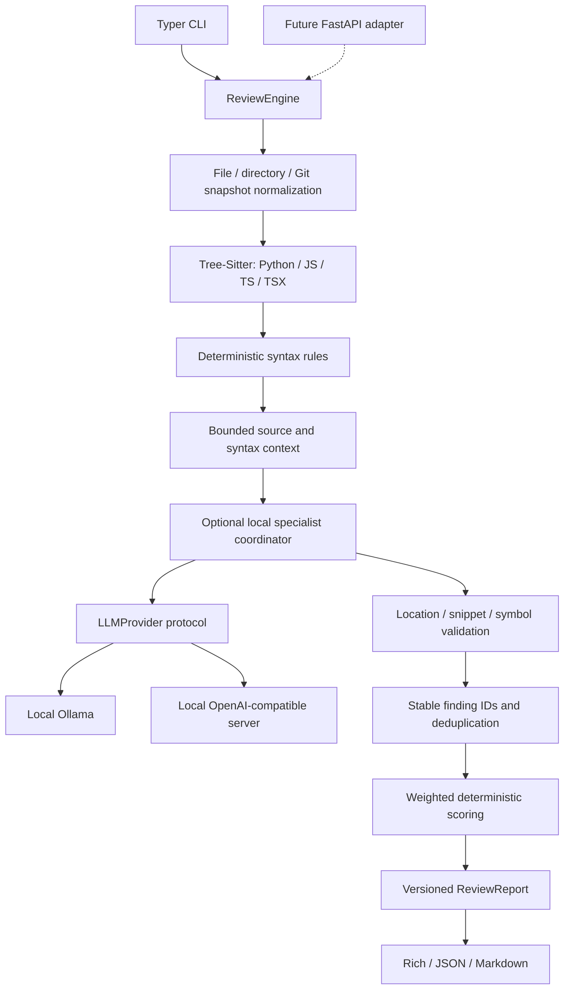

# Phase 1: implemented architecture

The core is a Python library. The CLI imports it; the core never imports CLI code.
A future FastAPI adapter can call exactly the same engine, using a worker thread or
job queue to avoid blocking its event loop. No API or final web UI is implemented yet.

## Module boundaries

- `core`: strict Pydantic domain contracts, settings, errors, metadata-only logging.
- `analysis`: installed Tree-Sitter grammars and Python AST / JavaScript-family rules.
- `review/input.py` and `review/git.py`: bounded source selection and safe Git blob reads.
- `agents`: a `ReviewAgent` protocol and four category specialists. They receive
  source/AST context and an `LLMProvider`, never a CLI, HTTP route or GitHub client.
- `llm`: schema-checked, size-limited local chat adapters. No automatic model downloads.
- `review`: composition, validation, deduplication, scoring and exact-preimage patches.
- `cli`: options, rendering, explicit report export and finding lookup.

There are no empty service folders or fake integrations. LangGraph, Semgrep, vector
retrieval, GitHub PR ingestion/posting, API, authentication and web dashboard are
deferred. A bounded sequential coordinator is simpler for this stateless MVP and
avoids concurrent model loads on local hardware. Semgrep can later implement a
static analyzer adapter; it is not needed for the current built-in rules. Retrieval
should extend the context builder without making a database mandatory.

## Input contract

Directory reviews include tracked and nonignored untracked source files. Tracked
files remain reviewable even if subsequently covered by `.gitignore`. Non-Git
directories use built-in excludes only. Explicit single-file review includes that
file even if Git ignores it. Supported source must be UTF-8; binary, oversized,
generated/vendor directories and symlink files are skipped. Budgets produce warnings.

`--staged` reads index blobs, including on an unborn branch. Unstaged edits do not
replace the index content. `--diff REF` compares a verified commit to tracked working
tree content, including staged additions, but not untracked files. Renames are treated
as delete/add. Only findings intersecting changed new-side hunk ranges enter the
score; out-of-scope findings remain in `rejected_findings`. Deletions and context-only
regressions are not analyzed. Diffs are calculated in memory from literal source
snapshots, so Git clean filters, diff drivers and text conversion are never invoked.
Filesystem monitor hooks and lazy network object fetching are disabled. Conflicted
indexes are rejected. Baseline and new source bytes both count against the byte budget.

The implementation is a local developer tool, not a hostile multi-tenant filesystem
sandbox. A repository changing concurrently with a review can produce inconsistent
worktree reads. Phase 2 should review immutable checkouts and isolate workers.

## Finding trust

All findings are validated against the actual scanned snapshot, including staged
content. An AI model cannot self-assert a trusted validation state or supply its own
authoritative evidence. File and line failures are rejected. Snippet/symbol mismatch
and unreliable parse context leave AI findings `UNVERIFIED` with zero score penalty.

`VERIFIED` means a deterministic rule matched, **not** that exploitability is proven.
`GROUNDED` means AI source evidence matched, **not** that its reasoning is correct.
AI confidence is capped at 0.85. Both false positives and false negatives remain
possible; there are no empirical accuracy or latency claims.

Deduplication uses file, rule ID and exact line range. The strongest validation wins,
then confidence and severity. Different paraphrases or rule IDs are not semantically
deduplicated. IDs are stable for identical locations/rules, but change when lines move.

## Score

Start at 100. Subtract each finding's severity weight times confidence times validation
weight, then clamp at zero. Severity weights: critical 25, high 12, medium 5, low 2,
info 0. Validation weights: verified 1, grounded 0.5, unverified/rejected 0.
Per-finding penalties are rounded to 0.001 and the final score to 0.01.
Every report exposes the formula and each contribution. Severity display filtering
never changes the score. An empty/partially scanned repository is not certified safe.

## Patch boundary

Suggestions require an exact whole-line preimage, safe relative path and an edit
range contained within the finding's cited lines. Unified
diffs are generated in memory; invalid suggestions are removed. Only the simple
standalone JavaScript/TypeScript `debugger` removal is generated deterministically
today. Models may suggest other fixes, but matching text does not prove correctness.
There is no apply command and no source mutation. Tests use `git apply --check` on
temporary fixtures to verify the emitted format.

## Free-resource policy and data flow

Default execution requires only Python, installed open-source dependencies and local
CPU/RAM. Git is needed for Git modes. No paid provider, database, container platform,
GPU, hosting account or recurring service is required. Installation downloads packages;
subsequent `--no-ai` reviews work offline.

AI is optional, explicitly configured, and restricted to loopback model servers.
Choose a model compatible with available hardware and its license. Local compute and
disk usage still apply. The tool rejects Ollama `:cloud` names and does not download
models. Operators must ensure their local server does not proxy requests to cloud
services. Four specialists consume at most `AICR_MAX_AI_CALLS` requests per review.
Oversized contexts are skipped explicitly, never silently truncated. Failed provider
requests preserve static findings and stop further requests for that review.

Source may contain sensitive information. When AI is enabled, selected source and
AST metadata are sent to the configured local server. Saved reports contain source
snippets and should be handled like source code. No reports or dotenv files are read
automatically from a reviewed repository. The CLI only loads a dotenv file explicitly
named by `--env-file`; process environment takes precedence. Logs omit source and
provider payloads. No telemetry is implemented.

## References used for adapters

- [Tree-Sitter Python bindings](https://tree-sitter.github.io/py-tree-sitter/)
- [Ollama chat API](https://docs.ollama.com/api/chat)
- [Ollama structured outputs](https://docs.ollama.com/capabilities/structured-outputs)
