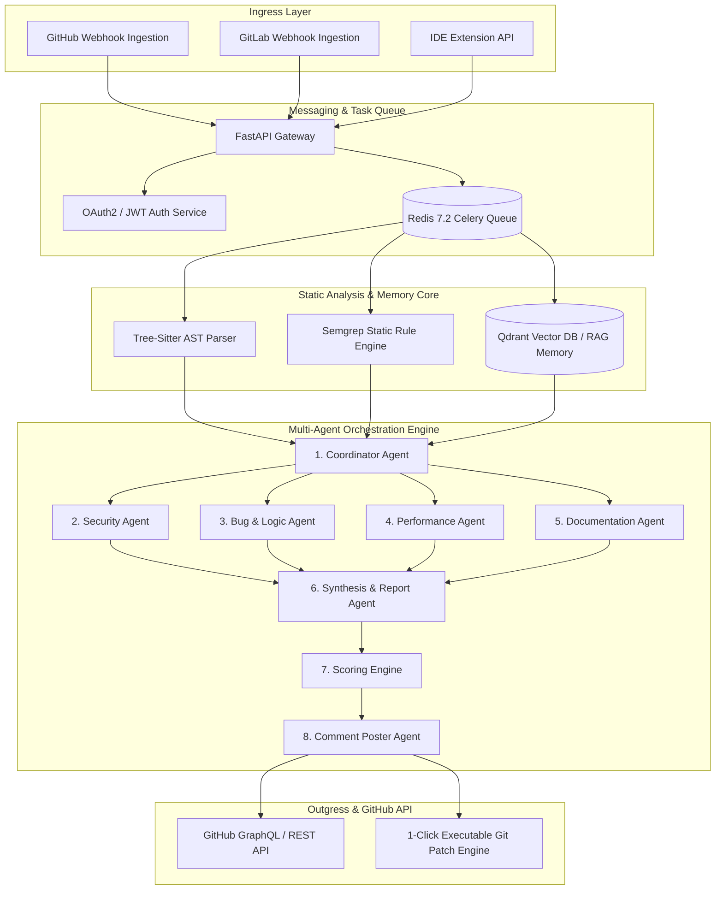
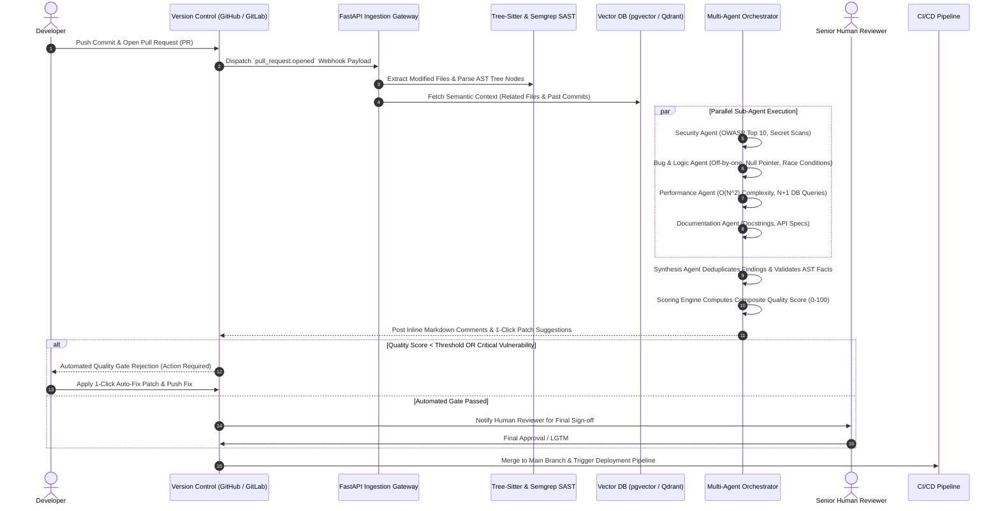

> Historical research proposal, not current implementation documentation. Accuracy, latency, market statistics and model benchmark tables below have not been verified for this project. See the root README and docs/phase1_architecture.md for implemented capabilities.

# 🤖 Agentic AI-Powered Automated Code Review System
### Next-Generation Multi-Agent Software Architecture, Static Analysis & RAG Platform


---

## 📌 Executive Overview

The **Agentic AI-Powered Automated Code Review System** is an enterprise-grade, multi-agent software engineering platform designed to bridge the gap between high delivery velocity and software reliability.

Traditional manual code reviews suffer from high turnaround latency (24–72 hours), reviewer cognitive fatigue on large pull requests, and missed security edge cases. Pure rule-based static analyzers (SAST) run quickly but lack semantic reasoning and produce high false-positive noise.

This system introduces a **hybrid deterministic-agentic architecture**: combining **Tree-Sitter Abstract Syntax Tree (AST) parsing** and **Semgrep static rule enforcement** with a **Multi-Agent Orchestration Engine** powered by frontier Large Language Models (Claude 3.5 Sonnet, DeepSeek-R1, GPT-4o). The platform delivers context-aware, evidence-grounded (with residual false-positive risk) code reviews with executable 1-click Git patches with latency still to be measured.

---

## 🏗️ System Architecture & Visual Schematics

### 1. High-Level Microservices Architecture



---

### 2. End-to-End Pull Request Sequence Flow



---

### 3. Multi-Agent System (MAS) State Machine & Communication Protocol

```mermaid
graph LR
    subgraph Input Phase
        RAW[PR Diff & AST Stream]
    end

    subgraph Dispatch Phase
        A1[Coordinator Agent]
    end

    subgraph Domain Reasoning Phase (Parallel)
        A2[Static Analysis Agent]
        A3[Security Agent]
        A4[Bug & Logic Agent]
        A5[Performance Agent]
        A6[Documentation Agent]
    end

    subgraph Verification & Output Phase
        A7[Synthesis & Cross-Check Agent]
        A8[Scoring & Confidence Engine]
        A9[GitHub Comment & Patch Poster]
    end

    RAW --> A1
    A1 --> A2
    A1 --> A3
    A1 --> A4
    A1 --> A5
    A1 --> A6

    A2 --> A7
    A3 --> A7
    A4 --> A7
    A5 --> A7
    A6 --> A7

    A7 --> A8
    A8 --> A9
```

---

## ⚙️ Deep Technical Explanation: How the System Works Under the Hood

### Step 1: Webhook Ingestion & Event Normalization
1. When a developer pushes commits or opens a Pull Request on GitHub/GitLab, a `pull_request.opened` or `pull_request.synchronize` webhook payload is dispatched to the **FastAPI Ingestion Gateway**.
2. The gateway verifies the HMAC cryptographic signature (`X-Hub-Signature-256`) to ensure authenticity.
3. The normalized payload (containing repository metadata, author info, branch names, commit SHAs, and raw git diffs) is enqueued as an asynchronous task into a **Redis 7.2 Celery Task Queue**.

---

### Step 2: AST Parsing & Deterministic Static Analysis
1. A Celery worker pulls the task and executes **Tree-Sitter**, an ultra-fast concrete syntax tree parser supporting 40+ programming languages.
2. Tree-Sitter converts raw changed code into an **Abstract Syntax Tree (AST)**. This allows the system to analyze code programmatically by node type (e.g., `FunctionDeclaration`, `BinaryExpression`, `IfStatement`) rather than treating code as raw unstructured text.
3. Simultaneously, **Semgrep** static rule engines execute lightweight SAST queries against the modified files to flag deterministic syntax violations, dead code, and hardcoded credentials.

```
Raw Code Diff ──> Tree-Sitter AST Parser ──> Concrete Syntax Nodes (S-Expressions)
                                                      │
                                                      ▼
                                       Semgrep Deterministic SAST Scan
```

---

### Step 3: Vector RAG & Codebase Knowledge Graph Memory
1. To evaluate how a PR diff impacts the broader codebase, the system queries a **Qdrant / pgvector Vector Database**.
2. Source code functions across the repository are pre-indexed into high-dimensional vector embeddings using OpenAI `text-embedding-3-large` or `CodeBERT`.
3. When analyzing a PR, the system extracts symbol references (imported classes, function calls, modified interfaces) and executes a k-Nearest Neighbors (k-NN) cosine similarity search to retrieve up to 5,000 tokens of relevant downstream contextual files.

---

### Step 4: Multi-Agent Orchestration & Communication Protocol
The core intelligence engine uses **LangGraph / Multi-Agent Orchestration** consisting of **9 specialized autonomous sub-agents**:

| Agent Name | Primary Responsibility | Input Context | Output Artifact |
| :--- | :--- | :--- | :--- |
| **1. Coordinator Agent** | Ingests PR webhook payload, parses diffs, extracts modified symbols, routes context to sub-agents. | Webhook JSON + AST Tree | Task Graph Dispatch Payload |
| **2. Static Analysis Agent** | Evaluates linter outputs, Tree-Sitter syntax errors, and coding style rules. | Tree-Sitter Nodes + Semgrep Output | Lint Diagnostic Report |
| **3. Security Agent** | Audits diff against OWASP Top 10, CWE Top 25, SQL injection, XSS, and secret leaks. | AST + Vulnerability Rules + LLM | Security Finding Stream |
| **4. Bug & Logic Agent** | Performs symbolic execution reasoning for off-by-one errors, null dereferences, and unhandled promises. | Modified Function AST + RAG Context | Logic Defect Stream |
| **5. Performance Agent** | Analyzes time/space complexity changes, $O(N^2)$ loops, memory leaks, and DB N+1 queries. | CFG Execution Paths | Algorithmic Efficiency Delta |
| **6. Documentation Agent** | Audits JSDoc/PyDoc coverage for modified public methods and drafts missing documentation. | Public Method Signatures | Standardized Docstring Patches |
| **7. Synthesis Agent** | Cross-checks sub-agent outputs against Tree-Sitter AST nodes to reduce unsupported model claims. | All Sub-agent Streams | Verified Final Diagnostic List |
| **8. Scoring Engine** | Computes composite quality score (0–100) using weighted Multi-Attribute Utility Theory. | Verified Diagnostic List | Composite Score & Traffic Light |
| **9. Posting Agent** | Formats verified findings into GitHub/GitLab markdown comments and 1-click executable patch diffs. | Final Report + Score | Inline PR Comments & Unified Diffs |

---

### Step 5: Grounded Hallucination Prevention & AST Cross-Verification
To reduce unsupported findings without guaranteeing correctness, the **Synthesis Agent** performs AST cross-verification:
- Every line number and code snippet cited by LLM reasoning agents (Security, Bug Logic, Performance) is matched against the actual Tree-Sitter syntax tree.
- If an agent references a variable name or line number that does not exist in the AST node range, the finding is discarded as a hallucination.

```
LLM Agent Finding ───┐
                     ├──> [Synthesis Cross-Verification] ──> Validated Finding (Posted to GitHub)
Tree-Sitter AST Node ──┘            │
                                    └──> Line/Symbol Mismatch ──> Discarded (Hallucination)
```

---

### Step 6: 1-Click Self-Healing Git Patch Generation
Instead of returning vague text recommendations, the system generates unified Git patches (`.patch` format). Developers can accept recommendations directly inside GitHub or apply them with one click:

```diff
# Unified Diff Patch Generated by AI Code Review System
--- a/src/user_repository.py
+++ b/src/user_repository.py
@@ -14,5 +14,7 @@ class UserRepository:
     def find_by_username(self, username: str) -> List[Dict[str, Any]]:
-        # Vulnerable to SQL Injection
-        query = f"SELECT * FROM users WHERE username = '{username}'"
-        cursor.execute(query)
+        # Parameterized query preventing SQL Injection
+        query = "SELECT id, username, email FROM users WHERE username = ?"
+        cursor.execute(query, (username,))
         return cursor.fetchall()
```

---

## 📊 Comprehensive Feature Matrix (30+ Intelligence Modules)

1. **AI Bug & Logic Error Detection**: Identifies subtle race conditions, off-by-one errors, and unhandled promise rejections.
2. **Automated Security Vulnerability Audit**: Real-time scanning against OWASP Top 10, CWE-Top 25, and hardcoded secret keys.
3. **Performance & Algorithmic Optimization**: Detects $O(N^2)$ bottlenecks, N+1 database queries, and memory leaks.
4. **Code Smell & Anti-Pattern Detection**: Flags bloated functions, long parameter lists, and circular dependencies.
5. **1-Click Self-Healing Git Patches**: Produces copy-pasteable unified diff patches for instant resolution.
6. **Coding Standards & Style Enforcement**: Ensures code matches team style guides (PEP 8, StandardJS, Google C++).
7. **Duplicate Code Deduplication**: Identifies structural code duplication across the monorepo.
8. **Cyclomatic Complexity Metrics**: Calculates McCabe complexity scores and recommends modular breakdowns.
9. **Architectural Boundary Enforcement**: Verifies clean layer isolation (e.g., UI layer cannot call DB directly).
10. **Dependency Vulnerability & License Check**: Audits `package.json`, `Cargo.toml`, or `requirements.txt` for known CVEs.
11. **Automated Documentation Generator**: Auto-generates JSDoc, PyDoc, or RustDoc strings for new APIs.
12. **Natural Language Code Explanation**: Explains complex algorithmic pull requests for non-author reviewers.
13. **Contextual Inline Commenting**: Posts polite, actionable inline comments directly on GitHub/GitLab diffs.
14. **Executive PR Review Summary**: Generates high-level summaries for engineering managers and leads.
15. **Composite Review Score (0–100)**: Computes an aggregate quality score balancing security, bugs, and maintainability.
16. **Maintainability Index Calculation**: Quantitative metric based on Halstead volume and lines of code.
17. **Security Risk Score**: Evaluates attack surface expansion introduced by the PR.
18. **Performance Delta Score**: Benchmarks estimated execution efficiency changes.
19. **Test Coverage Analysis & Gaps**: Identifies uncovered code paths and missing edge-case test conditions.
20. **Auto Unit Test Generation**: Generates ready-to-run PyTest / Jest test code for new functions.
21. **Interactive AI Chat with Repository**: Allows reviewers to ask "How does this PR affect user authentication?"
22. **Repository-Wide Semantic Search**: Finds related functions using natural language vector queries.
23. **Natural Language Code Queries**: Enables "Show all unauthenticated endpoints introduced this month".
24. **Historical PR Review Learning**: Remembers past reviewer feedback to refine future suggestions.
25. **Developer Analytics & Insights**: Visualizes team performance, recurring defect patterns, and velocity metrics.
26. **Smart Reviewer Recommendation**: Recommends human reviewers based on `git blame` ownership history.
27. **Code Ownership & Risk Prediction**: Predicts production incident probability based on file churn rates.
28. **Automated Merge Readiness Indicator**: Traffic-light system (Green/Yellow/Red) for CI merge decisions.
29. **Self-Healing PR Auto-Fix**: Optional GitHub Action setting allowing AI to commit fixes directly to PR branch.
30. **Air-Gapped On-Premise LLM Execution**: Supports Llama 3.3 / DeepSeek models for privacy-sensitive enterprise environments.

---

## 🤖 Frontier AI Models Comparative Evaluation

| Model Name | Vendor | Context Window | HumanEval Benchmark | Inference Speed | Primary Deployment Role |
| :--- | :--- | :--- | :--- | :--- | :--- |
| **Claude 3.5 Sonnet** | Anthropic | 200,000 Tokens | **92.0%** | Fast (~60 t/s) | Primary Review Engine & Structural Refactoring |
| **GPT-4o** | OpenAI | 128,000 Tokens | **90.2%** | Ultra-Fast (~80 t/s) | Fast PR Pre-screening & Summary Generation |
| **DeepSeek-R1** | DeepSeek | 64,000 Tokens | **90.8%** | Medium (~40 t/s) | Deep Algorithmic & Mathematical Logic Audits |
| **Gemini 1.5 Pro** | Google | 2,000,000 Tokens | **89.4%** | Medium (~45 t/s) | Entire Monorepo RAG Vector Context |
| **Llama 3.3 70B** | Meta AI | 128,000 Tokens | **82.6%** | Fast (~70 t/s) | On-Premise Air-Gapped Enterprise Execution |
| **Codestral 22B** | Mistral AI | 32,000 Tokens | **81.1%** | Ultra-Fast (>100 t/s)| Inline Linter Replacement & Fast Syntax Pre-check |

---

## 🛠️ Technology Stack & Infrastructure

```
+-----------------------------------------------------------------------------------+
|                                TECHNOLOGY STACK                                   |
+-------------------+-------------------+--------------------+----------------------+
| FRONTEND          | BACKEND           | DATABASES          | INFRASTRUCTURE       |
| Next.js 14        | FastAPI (Python)  | PostgreSQL 16      | Docker & Kubernetes  |
| React 18          | Node.js / Express | pgvector           | AWS EKS              |
| Tailwind CSS      | Celery Queue      | Qdrant Vector DB   | Helm & Terraform     |
| Shadcn UI         | Redis 7.2 Cache   | Redis Pub/Sub      | Prometheus & Grafana |
+-------------------+-------------------+--------------------+----------------------+
```

---

## 📁 Repository Structure

```
ai-code-review-system/
├── README.md                                  # Primary System Architecture & Setup Documentation
├── .gitignore                                 # Git Ignore File
├── docs/
│   ├── code_review_system_technical_documentation.md  # Complete 20-Section Proposal Artifact
│   ├── AI_Code_Review_System_Technical_Proposal.docx # Word Document (.docx) Format
│   └── code_review_proposal_document.html          # Printable PDF Document Format
├── public/
│   └── index.html                             # Interactive Web App (Dual-Mode 6-Page & 20-Section)
└── scripts/
    └── build_docx_document.py                 # Python Script to Compile Word Document
```

---

## 🚀 Quick Setup & Installation Guide

### Prerequisites
- Python 3.11+
- Node.js 18+
- Docker & Docker Compose
- Git 2.40+

### Local Setup Instructions

```bash
# 1. Clone the Repository
git clone https://github.com/kailash0001/ai-code-review-system.git
cd ai-code-review-system

# 2. Set Up Python Virtual Environment
python -m venv venv
# On Windows:
venv\Scripts\activate
# On Linux/macOS:
source venv/bin/activate

# 3. Install Python Dependencies
pip install python-docx

# 4. View Interactive Web Presentation Document
# Open public/index.html in any browser:
start public/index.html   # On Windows
open public/index.html    # On macOS
```

---

## 📚 Academic & Technical References (IEEE Format)

1. M. Fowler, *Refactoring: Improving the Design of Existing Code*, 2nd ed. Boston, MA: Addison-Wesley, 2018.
2. A. Bacchelli and C. Bird, "Expectations, outcomes, and challenges of modern code review," in *Proc. IEEE/ACM 35th Int. Conf. Software Eng. (ICSE)*, 2013, pp. 712–721.
3. Anthropic, "Claude 3.5 Sonnet Model Card & Code Benchmarks," Tech. Rep., June 2024. [Online]. Available: https://www.anthropic.com
4. OpenAI, "GPT-4 Technical Report," arXiv preprint arXiv:2303.08774, 2023.
5. DeepSeek AI, "DeepSeek-R1: Incentivizing Reasoning Capability in LLMs via Reinforcement Learning," arXiv preprint arXiv:2501.12948, Jan. 2025.
6. S. Sener et al., "Automated vulnerability detection using static analysis and deep learning: A survey," *IEEE Trans. Software Eng.*, vol. 49, no. 4, pp. 1820–1842, 2023.

---

## 📄 License
This project is licensed under the **MIT License** - see the LICENSE file for details.
